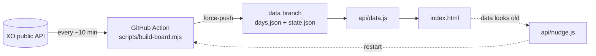

# Maco Board

**Daily profit leaderboard for [XO Market](https://beta.xo.market)'s markets and convictions.**
Who locked in the most today, who's racing ahead, and where you stand. One board for markets, one for convictions.

**→ [xo-maco-board.vercel.app](https://xo-maco-board.vercel.app)** · convictions: [`/#convictions`](https://xo-maco-board.vercel.app/#convictions)

## Features

- **Markets | Convictions | Contest**: three views behind one switch in the top bar. Contest (`/#competition`) shows while a contest is set in `config.json`.
- **Contest**: XO's official contest board for the contest's scope, ranked by volume: the race chart, the top 3, the leaderboard with prizes, and the rules. Read live from XO; only traders who joined are on it.
- **Today's race**: a racing line chart of the profit the leaders locked in today. Top 5 / 10 / 20, log or linear scale, drag to rewind, replay.
- **Biggest wins today**: the largest single-market profits of the day, with the market and the trader.
- **Top 3 and the leaderboard**: every ranked trader with profit, markets settled, win rate and stake, for today and the past 30 days.
  Tabs for Top PnL, Win rate, Biggest win, Staked and Rekt.
- **Find yourself** and **Share my rank** (an image or a short video for X), light and dark themes, phone-friendly, no cookies.

## What counts

- Profit counts on the day it is **locked in**, the way XO's own Net PnL does: when shares are sold, or when a resolved market pays out
  (or writes a position off). Open positions don't count until then.
- Each sale or payout in a trader's public activity carries its shares, its price and the position's average entry price, so its profit is
  `shares × (price − average entry)`. This matches XO's own figure to the cent. Fees are left out.
- **Staked** is what the settled shares cost. **Settled** counts the markets in which a trader sold or was paid out that day;
  a market that made money is a win.
- A day runs 00:00–24:00 UTC. Private profiles aren't ranked. Pulse rounds have [their own board](https://xo-pulse-board.vercel.app).

## How it works



The indexer, each run:

1. Lists the open and just-resolved markets and convictions. A market that has resolved since the last run puts its traders on a watch
   list for three days, because payouts land then.
2. Finds who traded: each market's trade feed (only for markets whose volume moved), and XO's single trade feed for all convictions.
3. Reads the sales and payouts of those traders, the watched ones, and a rolling sweep of everyone else (each trader at least every 6 hours,
   because limit-order fills leave no public trade).
4. Ranks every UTC day per board and writes `data/days.json`, the only file the page reads. `state.json` keeps what was already read.

## Run it locally

```sh
node dev.mjs                  # http://localhost:8774, re-runs the indexer every 10 minutes
NO_REFRESH=1 node dev.mjs     # serve only
```

The first build, or a rebuild, is thousands of requests, which Cloudflare blocks from GitHub's servers. Run it at home and publish it:

```sh
FULL=1 node scripts/build-board.mjs && scripts/publish.sh
```

## Deploy your own

1. Fork the repo and import it into [Vercel](https://vercel.com). No settings are needed for the static page and the `api/` functions.
2. Build the data once at home and publish it (above), then let the `board` Action keep it fresh.
3. Optional: a `GH_TOKEN` env var in Vercel (fine-grained, **Actions: read and write** on this repo) lets `api/nudge.js` restart the Action
   when GitHub skips its schedule, and lifts the GitHub API limit for `api/data.js`.
4. Change `REF` at the top of the page script to your own referral link.

## Configuration

`config.json`: `windowDays` is how many past days are (re)read, `exclude` lists usernames kept off the boards (XO's market maker), and `contest` (`slug`, `url`) names the XO contest behind the Contest view. Dates, prizes and rules come from XO. Remove it and the view goes away.

## Project layout

| Path | |
|---|---|
| `index.html` | The whole site (static, no build step). |
| `scripts/build-board.mjs` | The indexer (no dependencies). |
| `scripts/publish.sh` | Pushes local data to the `data` branch by hand. |
| `.github/workflows/board.yml` | Runs the indexer every ~10 min and publishes the data. |
| `api/data.js` | Serves `days.json` from the `data` branch through the GitHub API (raw.githubusercontent caches files for 5 minutes). |
| `api/nudge.js` | Restarts the Action when the data gets old. |
| `dev.mjs` | Local preview server. |

## XO API notes

- `marketScope=onlyClob` includes Pulse rounds (market type 3); markets are type 2, convictions type 4 (`onlyConviction`).
- `/markets/<id>/activity` lists taker trades only. `/markets/activities?marketScope=onlyConviction` is one feed for all convictions
  (the same call with `onlyClob` fails).
- A resolved win that hasn't been claimed yet shows no profit on XO, and it doesn't here either.

---

Built by **Andriy_shkinder** for the XO community, from XO's public data.
